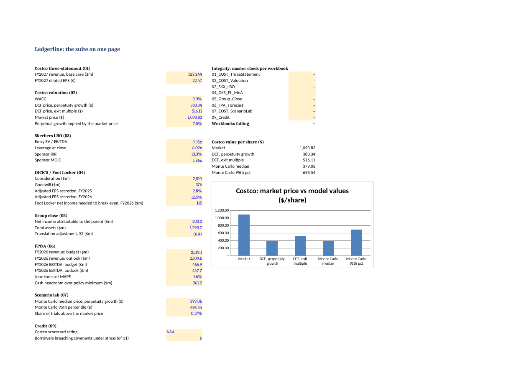
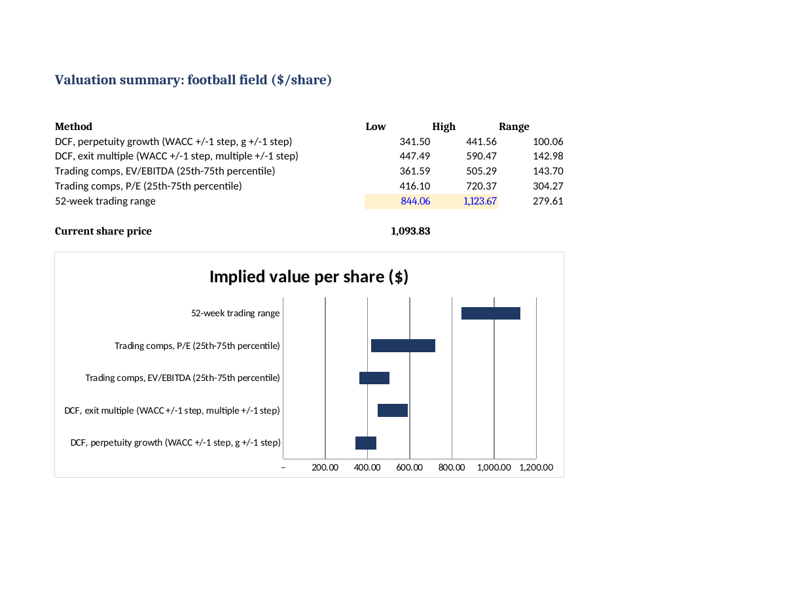
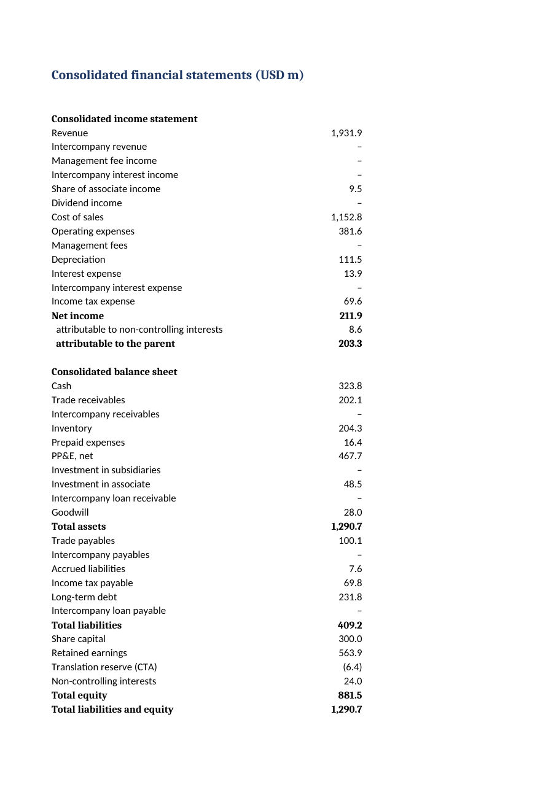
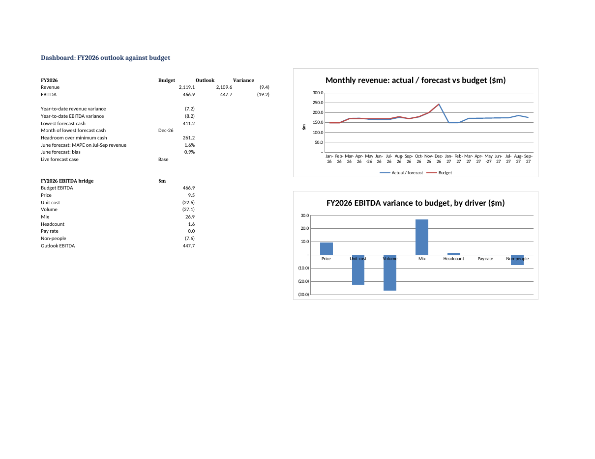
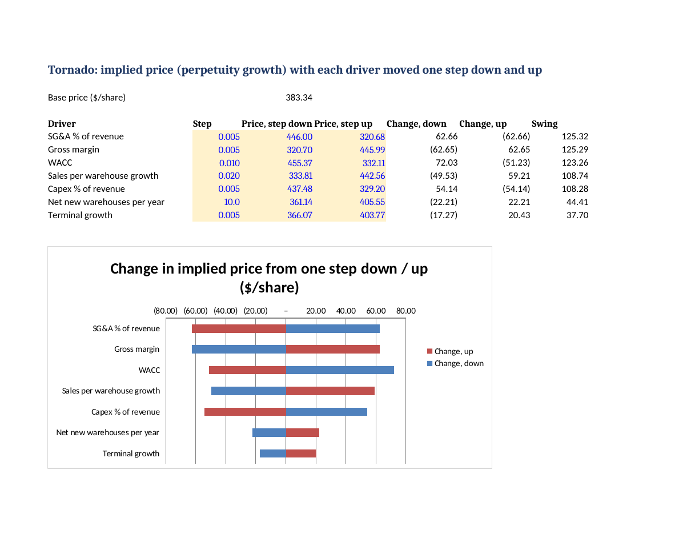
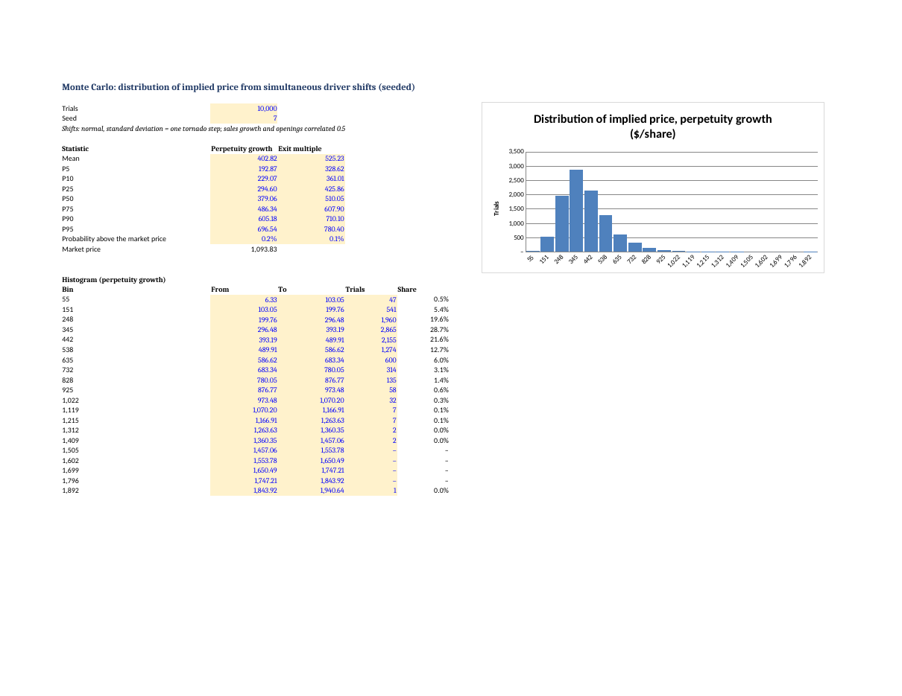

# Ledgerline

Institutional-grade Excel financial models built on public SEC filings, where **every workbook is
re-computed by an independent Python model and CI fails on a one-cent difference**.

Excel is the deliverable. Code exists to make the Excel trustworthy: a generator writes auditable,
FAST-standard workbooks with live formulas; a reference model checks them; an audit tool scans every formula;
and a mutation test proves the checks catch injected errors.

## Workbooks

| # | Workbook | Status |
|---|---|---|
| 00 | `00_Data.xlsx`: normalised 10-K history for Costco + 7 comps, live tie-out formulas | done (M1) |
| 01 | `01_COST_ThreeStatement.xlsx`: Costco three-statement model, 3 scenarios, revolver, circuit breaker | done (M2) |
| 02 | `02_COST_Valuation.xlsx`: WACC (FRED, Damodaran, regression beta), DCF both ways, reverse DCF, comps, sensitivity grids, football field | done (M3) |
| 03 | `03_SKX_LBO.xlsx`: Skechers / 3G Capital LBO with the real financing package, sweep, PIK toggle, covenants, IRR bridge; back-test memo | done (M4) |
| 04 | `04_DKS_FL_MnA.xlsx`: DICK'S / Foot Locker accretion-dilution: cash/stock election, PPA with bargain-purchase handling, synergies, breakeven lines, contribution, grids; back-test memo | done (M5) |
| 05 | `05_Group_Close.xlsx`: four-entity group (GBP subsidiary, 80% NCI) on seeded synthetic ledgers: close journals, current-rate translation with CTA roll-forward, 12 eliminations, statements, indirect cash flow, bank and intercompany recs, close checklist (VBA sign-off in `vba/`) | done (M6) |
| 06 | `06_FPA_Forecast.xlsx`: FY2026 driver-based budget, 9+3 rolling forecast with three cases, price / volume / mix / cost / headcount bridges (YTD and full year), June-forecast accuracy, cash headroom, dashboard charts; Power Query ingestion script in `powerquery/` | done (M7) |
| 07 | `07_COST_ScenarioLab.xlsx`: scenario manager (stress cases + manual shifts flowing through the whole Costco model), tornado, spider, seeded 10,000-trial Monte Carlo with histogram; memo; xlwings Excel-side runner | done (M8) |
| 09 | `09_Credit.xlsx`: spreads for 11 retailers, lease-adjusted leverage and coverage, Altman Z', scorecard rating and PD, covenant headroom, debt capacity, stress migration; exports for banking-risk and Tickforge (`exports/`, schemas in `docs/interfaces/`) | done (M9) |
| 08 | `08_Dashboard.xlsx`: the suite on one page, every number read from the recalculated workbooks with its source cell, plus every workbook's master check; `Ledgerline_Model_Book.pdf`: the printable book of all workbooks (bookmarked) | done (M10) |

## What it looks like

All images are pages of [`workbooks/Ledgerline_Model_Book.pdf`](workbooks/Ledgerline_Model_Book.pdf),
rendered by LibreOffice from the delivered workbooks (`python -m ledgerline.book`).

| | |
|---|---|
|  Dashboard (08) |  Costco football field (02) |
|  Consolidated statements (05) |  FP&A outlook vs budget (06) |
|  Tornado (07) |  Monte Carlo (07) |

## Verify

```bash
pip install -e ".[dev]"            # plus LibreOffice for headless recalculation
pytest -q                          # tie-outs; workbook vs reference on LibreOffice and `formulas`; audit
python -m ledgerline.build.workbooks                       # rebuild every workbook into workbooks/
python -m ledgerline.audit.audit workbooks/0*_*.xlsx --recalc   # writes .audit.md and .formulas.txt
python -m ledgerline.audit.mutation 01 --n 40              # seeded error injection (also 04, 05, 06), target >= 95% caught
python -m ledgerline.book                                  # model book PDF + bookmarks (LibreOffice UNO)
```

Refreshing data (reviewed change): `python -m ledgerline.data.history` (set `LEDGERLINE_UA` to your own
"name contact" string per SEC fair-access policy) and `python -m ledgerline.data.prices`.

## Layout

`spec/` analyst judgement per company (drivers, rationale) · `fixtures/` committed data snapshots ·
`python/ledgerline/{data,build,models,ref,audit}` · `docs/adr/` decisions · `docs/models/` model specs ·
`workbooks/` generated files.

Educational portfolio project. Not investment advice.
